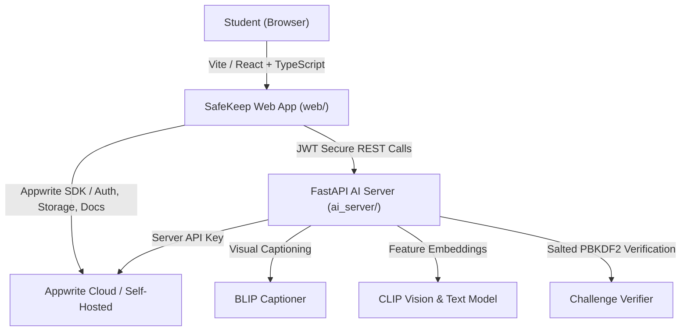

# SAFEKEEP: A Secure AI-Assisted Campus Lost and Found Web Platform

**Academic Mini-Project Report Implementation (CSET312)**

*School of Computer Science Engineering and Technology, Bennett University (Greater Noida, India)*

**Project Members:** Ayush Yadav, D.A S Vaishanth Babu, and Akshat Tiwari

---

## Abstract & Overview

Traditionally, lost-and-found systems on university campuses are fragmented across messaging groups and informal announcements. This makes it difficult to search past reports, leaves found items vulnerable to false claims, and exposes sensitive details.

**SafeKeep** solves these challenges by providing a centralized, privacy-first campus web application. It combines:
1. **Multimodal AI Candidate Retrieval**: Uses **BLIP** (Bootstrapping Language-Image Pre-training) for automated visual captioning and **CLIP** (Contrastive Language-Image Pre-training) for semantic vision-text embeddings and cosine similarity scoring.
2. **Appwrite Backend-as-a-Service**: Replaces external database solutions with **Appwrite** for student email authentication, document storage, image management, and document-level permission controls.
3. **Decoupled Discovery and Verification**: Found item reports are **strictly private and hidden** from the public feed. When a potential match is suggested, the claimant must prove ownership by answering an item-specific verification challenge (e.g. unique sticker, mark, engraving) verified against a salted server-side PBKDF2 cryptographic hash before contact is unlocked.

---

## System Architecture



### Technology Stack (Appwrite Powered)
| Component | Technology | Purpose |
| --- | --- | --- |
| **Frontend** | React 18, TypeScript, Vite, Lucide Icons | Responsive, intuitive campus web client |
| **Backend / DB** | Appwrite Databases | Items, matches, claims, verifications, messages |
| **Auth** | Appwrite Auth | Student registration, session tokens, JWTs |
| **File Storage** | Appwrite Storage (`item_images`) | Permission-controlled item photo storage |
| **AI Service** | Python 3, FastAPI, Uvicorn | Captioning, embeddings, ranking, hash verification |
| **AI Models** | Salesforce BLIP + OpenAI CLIP | Multimodal vision-language understanding |
| **Security** | Salted PBKDF2-HMAC-SHA256 | Ownership challenge-response verification |

---

## Core Algorithms

### Algorithm 1: Report Creation & Ingestion
1. Verify student identity and session.
2. Collect report metadata: title, description, location, timestamp, and photo.
3. If reporting a **found** item, require a private verification question and secret answer.
4. Upload photo to Appwrite Storage with appropriate document permissions (lost items readable by campus users; found items readable only by finder).
5. Generate BLIP caption and CLIP multimodal embedding via FastAPI `/process-item`.
6. Save document in Appwrite collection `items`.
7. For found items, salt and hash the answer using PBKDF2 in the protected `verifications` collection.
8. Trigger bidirectional candidate ranking against counterpart reports.

### Algorithm 2: Multimodal Candidate Match Ranking
1. Retrieve query item and candidate pool (open counterpart items).
2. Compute cosine similarity $S_{\text{image}}$ between CLIP embeddings.
3. Compute Jaccard/text similarity $S_{\text{text}}$ across titles, descriptions, and AI captions.
4. Compute location compatibility boolean $S_{\text{location}}$.
5. Compute composite similarity score:
   $$\text{Score} = 0.70 \times S_{\text{image}} + 0.20 \times S_{\text{text}} + 0.10 \times S_{\text{location}}$$
6. Filter by threshold ($\text{Score} \ge 0.60$).
7. Record suggested candidate in protected `matches` collection. Found report details are **never** returned to the claimant.

### Algorithm 3: Challenge-Response Claim Verification
1. Claimant inspects suggested candidate match and initiates a claim challenge.
2. Server returns only the finder's challenge prompt (e.g., *"What sticker is on the back?"*).
3. Claimant enters their private identifying detail.
4. Server hashes candidate answer with stored salt (`310,000` PBKDF2 iterations) and compares constant-time digest (`hmac.compare_digest`).
5. **Success**: Claim is verified, status becomes `claimed`, and a private chat channel unlocks between finder and claimant.
6. **Failure**: Decrement remaining attempts (maximum 3 attempts). If attempts reach zero, the claim is permanently locked to protect the rightful owner.
7. **Return Handover**: Upon physical meeting, either party marks the item as `returned`.

---

## Repository Structure (Section 3.6.2 Compliance)

```text
├── run.sh                          # 1-command startup script for all services
├── APPWRITE_SETUP.md               # Appwrite setup documentation
├── scripts/
│   ├── setup-appwrite.py           # Automated Appwrite database/storage provisioner
│   └── run-ai.sh                   # AI service runner
├── web/                            # React + TypeScript client
│   ├── src/
│   │   ├── services/               # Appwrite and FastAPI API clients
│   │   │   ├── appwrite.ts         # Appwrite Client, Databases, Storage & Auth
│   │   │   ├── api.ts              # Unified application API
│   │   │   └── mockData.ts         # Demo campus mode fallback state
│   │   ├── features/
│   │   │   ├── items/              # Lost feed, item details, reporting, my reports
│   │   │   │   ├── Feed.tsx
│   │   │   │   ├── ItemCard.tsx
│   │   │   │   ├── ItemDetailsModal.tsx
│   │   │   │   ├── ReportModal.tsx
│   │   │   │   └── MyReports.tsx
│   │   │   ├── claims/             # Candidate matches & verification challenge
│   │   │   │   ├── MatchesView.tsx
│   │   │   │   └── ClaimModal.tsx
│   │   │   └── chat/               # Verified messaging & return handover
│   │   │       └── ChatView.tsx
│   │   ├── components/             # Reusable UI (Navbar, Dialogs, Auth)
│   │   ├── types.ts                # TypeScript interfaces
│   │   ├── App.tsx                 # Core application controller
│   │   └── styles.css              # Responsive campus design styling
│   └── package.json
└── ai_server/                      # FastAPI AI & workflow backend
    ├── main.py                     # BLIP, CLIP, ranking, and verification endpoints
    ├── requirements.txt            # Python dependencies
    └── Dockerfile
```

---

## Quickstart & Local Setup

### 1. One-Command Automated Run
On a fresh checkout, prepare the Python environment from the project root:

```bash
python3 -m venv ai_server/venv
ai_server/venv/bin/python -m pip install -r ai_server/requirements.txt
```

From the project root:
```bash
./run.sh
```
This script will:
- Detect your laptop's local network IP (e.g. `http://10.12.45.239:5173`).
- Start the FastAPI AI server on `0.0.0.0:8000` with **hardware acceleration (NVIDIA RTX 4060 GPU)**.
- Launch the Vite React web client on `0.0.0.0:5173`.
- Enable other campus devices (phones, tablets, laptops) on the same Wi-Fi network to connect directly!

> **Local Laptop as a Server**:
> * Web App: `http://<YOUR_LAPTOP_IP>:5173`
> * AI Service API: `http://<YOUR_LAPTOP_IP>:8000`
> * Pre-cached local models: BLIP (`Salesforce/blip-image-captioning-base`) & CLIP (`openai/clip-vit-base-patch32`) in `ai_server/model_cache`.
>
> **Demo Campus Mode**: If you have not configured live Appwrite credentials yet, SafeKeep automatically launches in **Demo Campus Mode** with interactive Bennett University campus mock data, allowing you to test the complete feed, reporting, match detection, 3-attempt verification, and chat handover immediately!

### 2. Automated Appwrite Provisioning
To link a live Appwrite Cloud or self-hosted project:
1. Copy and fill in your Appwrite Project ID and Server API Key in `ai_server/.env` and `web/.env.local`.
2. Run the automated setup tool:
   ```bash
   python3 scripts/setup-appwrite.py
   ```
This provisions the database, all collections, attributes, indexes, and bucket permissions automatically.

---

## References

1. A. Radford et al., *"Learning Transferable Visual Models from Natural Language Supervision,"* arXiv:2103.00020, 2021.
2. J. Li et al., *"BLIP: Bootstrapping Language-Image Pre-training for Unified Vision-Language Understanding and Generation,"* ICML, 2022.
3. N. Reimers and I. Gurevych, *"Sentence-BERT: Sentence Embeddings using Siamese BERT-Networks,"* arXiv:1908.10084, 2019.
4. Appwrite Documentation, *"Databases, Authentication, and Storage,"* Appwrite Documentation, 2026.
